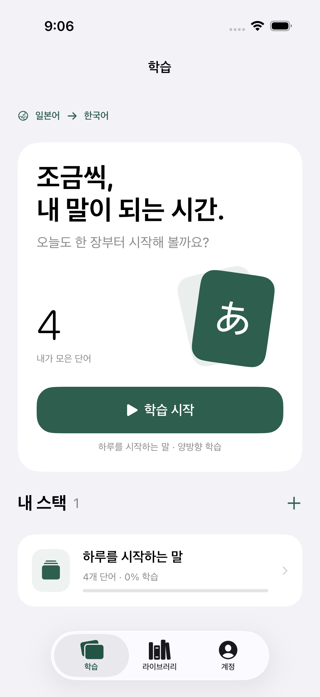
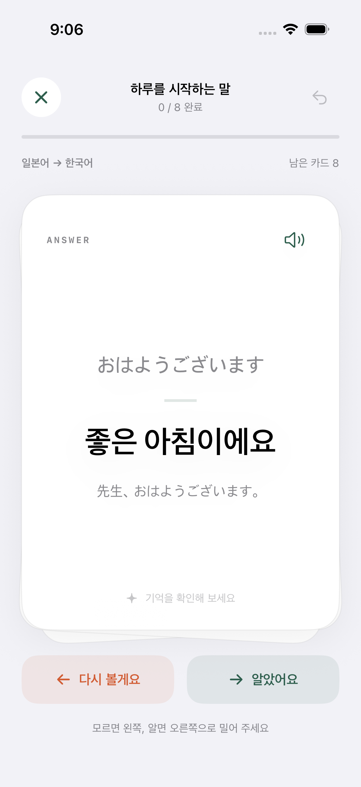
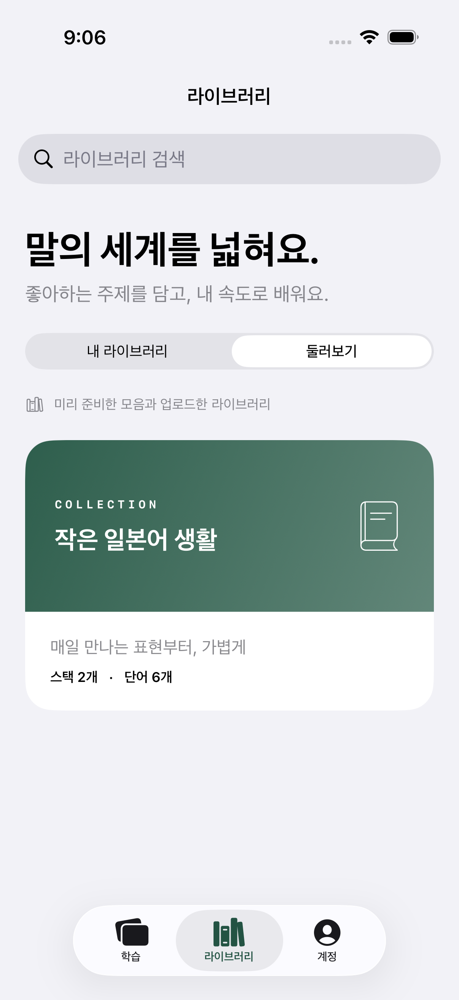
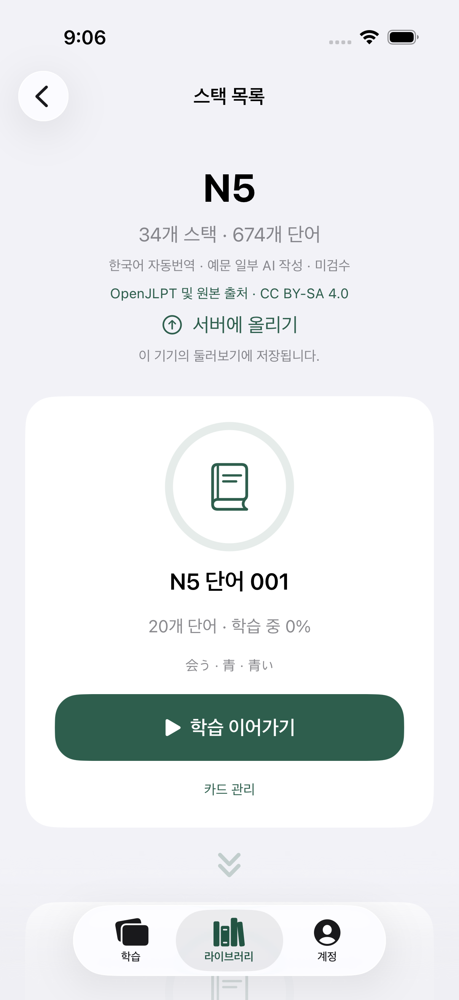
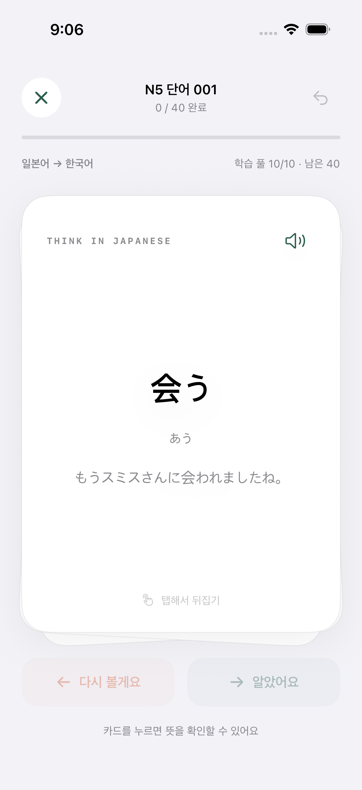

# CardVoca

일본어를 한국어로 학습하는 SwiftUI iOS 앱. iOS 17 이상, 외부 패키지 의존성 없음.

## 실행

1. `voca-ios.xcodeproj`를 Xcode에서 연다.
2. `voca-ios` scheme과 iPhone 시뮬레이터를 선택하고 Run.
3. 실제 iPhone에서는 Signing & Capabilities에서 본인의 Apple 개발 팀을 선택한다. Bundle Identifier는 필요하면 본인 값으로 변경한다.

프로젝트 파일이 포함되어 있어 XcodeGen 설치 없이 실행할 수 있다. 프로젝트 설정 변경 후 재생성하려면 `xcodegen generate`를 실행한다.

## 기능

- **학습**: 스택 생성, 카드 추가/삭제, 양방향 카드, 진행률 저장, 완료 후 재학습.
- 앞면은 일본어 또는 한국어를 보여주고, 뒷면에서 뜻과 읽는 법을 확인한다. 앞면의 읽는 법은 설정에서 켜거나 끌 수 있다.
- 뒷면에서만 좌우 스와이프 가능. 손가락 추적, 회전, 속도 기반 판정, 스프링 복귀, 판정 배지, 햅틱과 버튼 대안 제공. 시스템 동작 줄이기 설정을 반영한다.
- 학습 풀은 기본 20장이며 설정 → 학습 설정에서 1~100장으로 변경한다. 설정은 학습 기록과 함께 기기에 저장된다. 같은 단어의 양방향이 동시에 들어가지 않는다. 모르는 방향은 풀 안에서 최소 세 장 뒤에 다시 등장하고, 정답일 때만 새 항목이 들어온다. 보충 카드는 새 단어를 우선하고, 역방향만 남았을 때는 오래전에 정답 처리한 단어부터 넣는다. 카드가 남아 있으면 풀을 설정한 크기로 채우며, 작은 스택에서 간격을 확보할 수 없으면 가능한 만큼만 띄운다. 양방향 또는 단방향 설정에 따라 필요한 방향을 맞히면 스택 완료. 문장은 항상 단방향이다. 직전 응답 한 번 취소 가능.
- 일일 학습 목표는 기본으로 꺼져 있으며, 켜면 100회가 초기 목표다. 카드 표시를 모두 세며 목표에 도달하면 아직 보지 않은 카드는 다음 날로 미룬다. 이미 본 카드의 복습은 이어지며, ‘오늘만 더 학습하기’를 선택하면 그날은 제한 없이 진행한다.
- 내 스택이나 가져온 덱에서 카드 뜻을 수정할 수 있다. 설정 → 내 카드 뜻 수정 기록에서 확인하고 공유한다. 수정은 이 기기에만 반영되며 Google Sheets 원본이나 제작자에게 자동으로 전송되지 않는다.
- 내 스택의 카드와 스택을 삭제할 수 있다. 카드 삭제 시 해당 카드의 학습 기록도 지워진다. 내 라이브러리의 로컬 사본을 제거해도 내 스택에 등록한 사본과 둘러보기의 게시 사본은 유지된다.
- 작업 브랜치는 `main`을 사용한다.
- **라이브러리**: Google Sheets 파일 단위. 내부 탭 하나는 **덱**, 덱 안의 `stack` 그룹은 **세트**다. 공개 라이브러리의 덱별 가져오기, 스택별 내 학습 목록에 복사, 중복 등록 방지. 둘러보기는 운영자가 검수한 공개 목록을 읽는다.
- **기본 모음**: ‘묶어서 외우는 일본어’ 라이브러리에 요일, 월, 날짜, 사람 수, 물건·책·동물 등의 세는 법을 11개 스택으로 제공한다. 같은 내용이 [Google Sheets의 별도 탭](https://docs.google.com/spreadsheets/d/1CZiD8VuxZ6iqrMeBGREO-MAhStjL-dOIJQsj2SiP-Q4/edit?gid=2026102501)에도 있다. 시트에서 가져온 카드는 해당 시트 범위의 고유 ID를 사용한다.

- **반복 학습**: 학습 중 담은 단어를 일본어 → 한국어 방향으로 확인하고, 맞히면 다음 단계로 이동한다. 마지막 단계 완료 단어는 별도로 보관한다. 모든 단계의 단어를 한 흐름으로 학습하고, 이번 흐름에서 맞힌 단어는 다시 나오지 않으며, 다음 단계에서는 설정한 정시 대기시간 이후 등장한다. 카드별 단계는 하나만 유지한다. 기본 5단계, 최대 20단계, 단계업 대기시간 기본 1일이다.
- **가나 모드**: 학습·반복 학습에서 한자 대신 읽기(히라가나·가타카나)를 표시한다. 읽기가 공백 또는 하이픈이면 일본어 원문을 사용한다. 공통 학습 설정은 설정 탭과 학습 중 더보기에서 열 수 있다.
- **검색**: 설정에서 사이트별 이름·HTTPS 검색 템플릿·표시 여부를 관리한다. Chrome으로 열기를 시도하고 없으면 기본 브라우저를 사용한다.
- **설정**: 양방향·단방향, 반복 단계업 대기시간, 학습 풀, 반복 단계 수, 앞면 읽기, 햅틱, 검색, 뜻 수정 기록, 개발자와 좋아요, 개인정보 안내.
- 알림·시스템 알람·단축어 기능은 제거했다. 과거 예약을 취소하는 호환 처리만 있으며 권한은 요청하지 않는다.
- 실제 통신 없이 복제하던 서버 게시 기능을 제거했다. 공개 목록은 Google Sheets로 관리하고 등록 요청은 Google Form으로 받는다. 기존에 저장한 자료는 보존한다.

## Google Sheets 가져오기

1. 라이브러리 → Google Sheets 가져오기.
2. 읽기 공개한 원본 스프레드시트 링크를 입력한다.
3. ‘시트 목록 확인’으로 실제 탭 목록을 읽은 후 N5~N1이나 ‘묶어서 외우는 일본어’를 선택한다.
4. ‘가져오기’를 누르면 **선택한 시트 하나가 덱 하나**가 된다.
5. 세로로 이어지는 스택 목록에서 원하는 스택을 ‘내 스택에 추가’한다. 각 스택에 진행률과 완료 여부를 표시한다.

덱의 필수 열은 `stack`, `ja-JP`, `ko-KR`이다. 읽는 법은 `ja-JP-reading`을 사용한다(기존 `reading`도 계속 읽음). `card_id`는 선택 사항이다. 생략하면 앱이 `stack + ja-JP + ja-JP-reading + type`으로 안정적인 ID를 만들므로 행을 삽입하거나 삭제해도 기존 카드가 유지된다. 같은 표기와 읽기를 여러 카드에 쓰거나 일본어 표기를 나중에 수정할 계획이면 각 카드에 변하지 않는 `card_id`를 적어야 한다. 카드 ID에는 시트 파일과 탭 주소도 포함하므로 서로 다른 라이브러리에서 같은 `card_id`를 써도 충돌하지 않는다. 공개 목록 파일의 열은 `라이브러리 그룹 이름`, `Google Sheets 링크`, `상태`(TRUE/FALSE), `설명`, `닉네임`이다. 그룹을 누르면 설명과 등록자 이름을 볼 수 있다. 운영자가 승인한 그룹만 앱의 둘러보기에 나타난다.

로그인 전용 파일과 자동 동기화는 지원하지 않는다. 공개 `htmlview`의 탭 목록을 파싱하므로 Google 응답 형식이 변경되면 오류를 표시한다. 존재하지 않는 이름을 입력했을 때 첫 탭으로 대체되는 Google의 동작을 피하기 위해, 확인된 탭의 `gid`로만 내려받는다. 같은 파일·탭을 다시 가져오면 덱 사본을 갱신한다. 이미 학습 목록에 등록한 스택의 데이터·진행률은 유지한다.

[JLPT 데이터와 출처](Data/JLPT/README.md): N5 674 / N4 630 / N3 1,659 / N2 1,778 / N1 3,070, 합계 7,811개 항목을 최대 20개씩 392개 스택으로 구성했다. 공식 전체 출제 어휘가 아닌 OpenJLPT 공개 목록 전체다. **한국어는 자동번역이며 미검수다.** CSV 백업과 CC BY-SA 4.0 출처·라이선스를 포함한다.

[출시 점검표](docs/release-checklist.md)에서 제출 준비 상태와 남은 사용자 결정을 확인한다.

앱 아이콘은 겹친 카드와 `あ`를 사용한 1024px 이미지다. `scripts/make-icon.swift`로 재생성할 수 있다.

## 저장과 구조

- `Sources/VocaCore`: Codable 모델, 학습 큐, 시트 데이터 검증, 시트 URL 변환.
- `VocaApp`: SwiftUI 화면, 로컬 저장, Google Sheets 다운로드.
- `Tests`: Foundation 기반 핵심 로직 테스트.
- `UITests`: 시뮬레이터의 스와이프/되돌리기/라이브러리 등록 테스트.

앱 Documents의 `voca-data.json`에 원자적으로 저장한다. 학습 목록과 라이브러리는 독립 사본이며 원본 라이브러리 변경은 이미 등록한 스택에 자동 반영하지 않는다. 학습 언어는 현재 일본어/한국어 고정이며, 다른 언어를 제공하려면 모델 필드와 UI 설정을 확장해야 한다. 앱 삭제 시 로컬 데이터가 없어질 수 있다.

## 검증

```sh
swift test
xcodebuild -project voca-ios.xcodeproj -scheme voca-ios \
  -destination 'platform=iOS Simulator,name=iPhone 17 Pro' test
```

기본 UI 테스트는 네트워크 없이 동작한다. `TEST_RUNNER_VOCA_LIVE_SHEET_TEST=1`을 붙여 `xcodebuild test`를 실행하면 공개 JLPT 시트를 실제로 가져오는 테스트를 추가한다.

UI 테스트의 `--uitesting` 인자는 Debug에서만 별도 임시 저장 파일을 사용한다. 일반 사용자 저장 파일은 변경하지 않는다.

## 화면 미리보기

| 학습 | 카드 뒷면 | 라이브러리 |
| --- | --- | --- |
|  |  |  |

| 시트별 스택 | 학습 풀 (이전 버전 화면) |
| --- | --- |
|  |  |

문장 덱은 `type` 열에 `sentence`를 적는다. `type`을 생략하거나 `word`로 두면 단어 카드다. 문장 카드는 단방향으로만 학습한다. 다른 언어 코드 열(예: `en-US`)도 가져올 때 번역 데이터에 보존한다.
