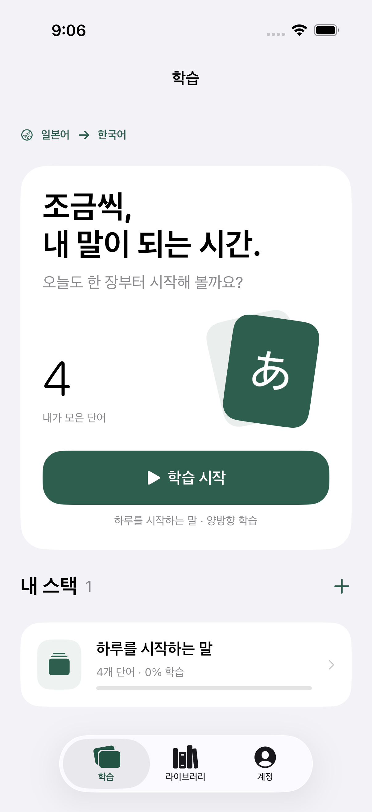
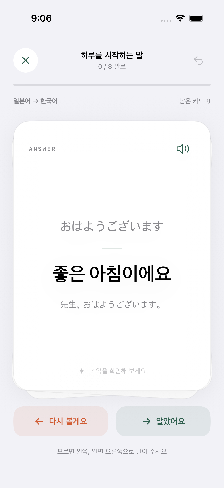
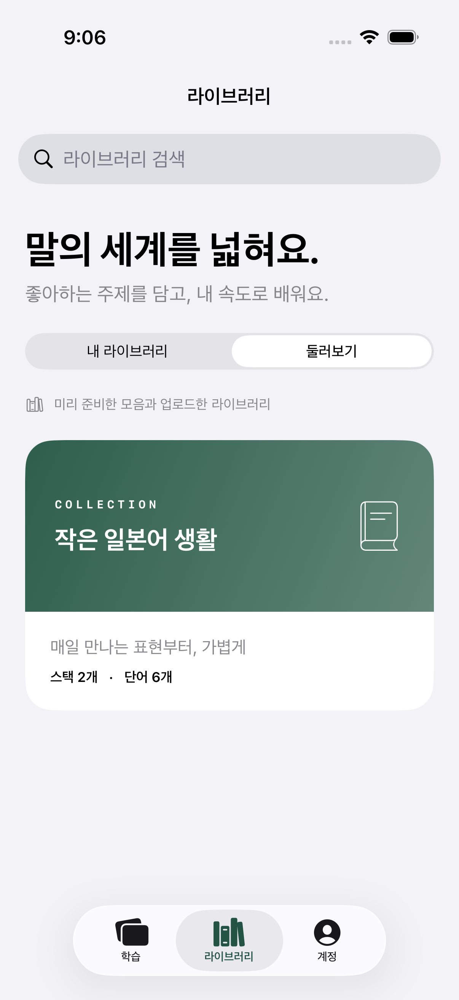
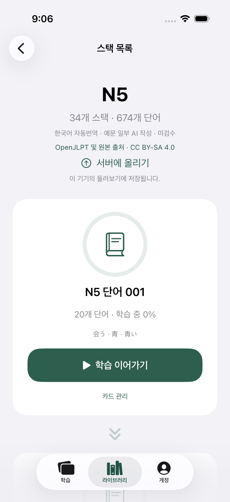
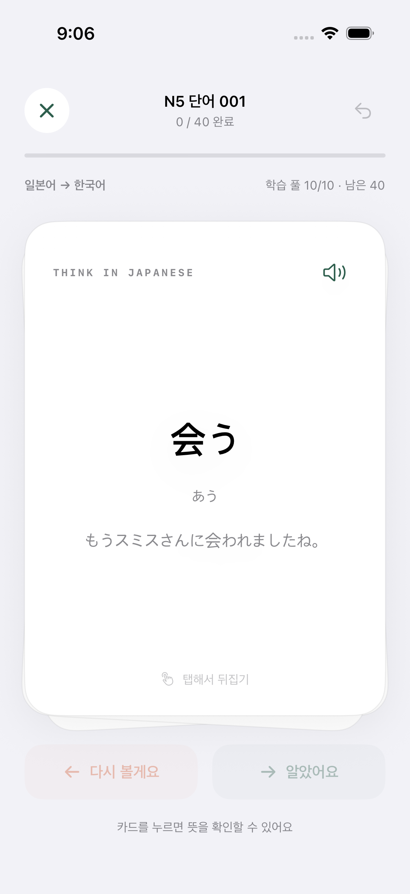

# voca-ios

일본어를 한국어로 학습하는 개인용 SwiftUI iOS 앱. iOS 17 이상, 외부 패키지 의존성 없음.

## 실행

1. `voca-ios.xcodeproj`를 Xcode에서 연다.
2. `voca-ios` scheme과 iPhone 시뮬레이터를 선택하고 Run.
3. 실제 iPhone에서는 Signing & Capabilities에서 본인의 Apple 개발 팀을 선택한다. Bundle Identifier는 필요하면 본인 값으로 변경한다.

프로젝트 파일이 포함되어 있어 XcodeGen 설치 없이 실행할 수 있다. 프로젝트 설정 변경 후 재생성하려면 `xcodegen generate`를 실행한다.

## 기능

- **학습**: 스택 생성, 카드 추가/삭제, 양방향 카드, 진행률 저장, 완료 후 재학습.
- 앞면은 일본어와 예문, 뒷면은 한국어 뜻을 강조한다. 한국어→일본어 방향에서는 정답을 노출하지 않도록 일본어 예문과 음성을 뒷면에서 제공한다.
- 뒷면에서만 좌우 스와이프 가능. 손가락 추적, 회전, 속도 기반 판정, 스프링 복귀, 판정 배지, 햅틱과 버튼 대안 제공. 시스템 동작 줄이기 설정을 반영한다.
- 학습 풀은 기본 20장이며 계정 → 학습 설정에서 1~100장으로 변경한다. 설정은 학습 기록과 함께 기기에 저장된다. 같은 단어의 양방향이 동시에 들어가지 않는다. 모르는 방향은 풀 안에서 최대 세 장 뒤에 다시 등장하고, 정답일 때만 새 항목이 들어온다. 최근 정답 단어는 설정한 풀 크기만큼 기억해 역방향 진입을 미루며, 남은 단어가 적으면 풀을 줄인 뒤 오래전에 본 단어부터 다시 시작한다. 단어 한 개만 남으면 간격을 확보할 수 없다. 모든 단어의 양방향을 맞히면 스택 완료. 직전 응답 한 번 취소 가능.
- 학습 카드와 카드 목록에 일본어 복사 버튼을 제공한다. 한국어가 앞면인 카드는 정답을 공개한 뒤에 복사할 수 있다.
- 라이브러리 또는 스택의 깃발 버튼에서 단어와 오류 내용을 선택해 제보를 저장한다. 계정 → 단어 오류 제보함에서 확인하고 공유한다. 제보는 원래 단어의 내용과 식별자를 보존하며 자동 전송하거나 원본 시트를 수정하지 않는다.
- 내 스택의 카드와 스택을 삭제할 수 있다. 카드 삭제 시 해당 카드의 학습 기록도 지워진다. 내 라이브러리의 로컬 사본을 제거해도 내 스택에 등록한 사본과 둘러보기의 게시 사본은 유지된다.
- 작업 브랜치는 `main`을 사용한다.
- **라이브러리**: 직접 생성, 스택/카드 구성, JSON/CSV/Google Sheets 가져오기, 스택별 내 학습 목록에 복사, 중복 등록 방지.
- **가짜 서버**: 업로드한 라이브러리를 기기 내 별도 목록에 보관하고 둘러보기에 표시한다. 동일 라이브러리 재업로드는 해당 서버 사본을 갱신한다. 다른 기기에는 전송하지 않는다.
- **계정**: 언어/완료 기준 표시, 햅틱 설정. 로그인·결제·구독은 미구현이며 이를 화면에 명시한다.
- 일본어 음성은 iOS의 AVSpeechSynthesizer 사용. 음성 가용성은 기기 설정에 따라 달라진다.

## 가져오기

[JSON 예제](Samples/japanese.json), [CSV 예제](Samples/japanese.csv)를 참고한다.

JSON:
```json
{
  "title": "여행 일본어",
  "stacks": [{
    "title": "카페에서",
    "cards": [{
      "japanese": "おすすめ",
      "korean": "추천",
      "example": "おすすめは何ですか。"
    }]
  }]
}
```

CSV는 UTF-8, 필수 헤더 `japanese,korean,example`을 사용한다. 예문 셀은 비어 있어도 되지만 일본어·한국어는 필수다. `stack_id`로 그룹화하고 `stack`을 이름으로 표시한다. `stack_id`가 없으면 `stack` 이름으로 묶는다. `card_id`는 안정적인 카드 식별자, `reading`은 읽기 표시다. 쉼표·줄바꿈·따옴표는 표준 CSV 따옴표 규칙을 따른다. 중복 헤더/ID와 번역 오류·계산 대기 값은 거부한다.

Google Sheets 가져오기:

1. 라이브러리 → 만들기 또는 가져오기 → Google Sheets 링크.
2. ‘JLPT N5–N1 단어장 링크 사용’을 누르거나, 읽기 공개한 원본 스프레드시트 링크를 입력한다.
3. ‘시트 목록 확인’으로 실제 탭 목록을 읽은 후 원하는 시트를 선택한다.
4. ‘가져오기’를 누르면 **선택한 시트 하나가 라이브러리 하나**가 된다.
5. 세로로 이어지는 스택 목록에서 원하는 스택을 ‘내 스택에 추가’한다. 각 스택에 진행률과 완료 여부를 표시한다.

로그인 전용 파일과 자동 동기화는 지원하지 않는다. 공개 `htmlview`의 탭 목록을 파싱하므로 Google 응답 형식이 변경되면 오류를 표시한다. 존재하지 않는 이름을 입력했을 때 첫 탭으로 대체되는 Google의 동작을 피하기 위해, 확인된 탭의 `gid`로만 내려받는다. 같은 파일·탭을 다시 가져오면 라이브러리 사본을 갱신한다. 이미 학습 목록에 등록한 스택의 데이터·진행률은 유지한다.

[JLPT 데이터와 출처](Data/JLPT/README.md): N5 674 / N4 630 / N3 1,659 / N2 1,778 / N1 3,070, 합계 7,811개 항목을 최대 20개씩 392개 스택으로 구성했다. 공식 전체 출제 어휘가 아닌 OpenJLPT 공개 목록 전체다. **한국어는 자동번역, 누락 예문 566개는 AI 작성이며 미검수다.** CSV 백업과 CC BY-SA 4.0 출처·라이선스를 포함한다.

[세 번 반복학습 설계안](docs/repetition-design.md)은 아침 뜻 연결 → 낮 역방향 회상 → 저녁 예문 회상을 제안한다. 현재 앱에는 구현하지 않았다.

앱 아이콘은 겹친 카드와 `あ`를 사용한 1024px 이미지다. `scripts/make-icon.swift`로 재생성할 수 있다.

## 저장과 구조

- `Sources/VocaCore`: Codable 모델, 학습 큐, CSV/JSON 검증, 시트 URL 변환. 향후 서버 교체 시 UI와 분리해서 재사용할 수 있다.
- `VocaApp`: SwiftUI 화면, 로컬 저장, TTS, Google Sheets 다운로드.
- `Tests`: Foundation 기반 핵심 로직 테스트.
- `UITests`: 시뮬레이터의 스와이프/되돌리기/라이브러리 등록 테스트.

앱 Documents의 `voca-data.json`에 원자적으로 저장한다. 학습 목록과 라이브러리는 독립 사본이며 원본 라이브러리 변경은 이미 등록한 스택에 자동 반영하지 않는다. 학습 언어는 현재 일본어/한국어 고정이며, 다른 언어를 제공하려면 모델 필드와 UI 설정을 확장해야 한다. 앱 삭제 시 로컬 데이터가 없어질 수 있다.

## 검증

```sh
swift test
xcodebuild -project voca-ios.xcodeproj -scheme voca-ios \
  -destination 'platform=iOS Simulator,name=iPhone 17 Pro' test
```

기본 UI 테스트는 네트워크 없이 동작한다. `TEST_RUNNER_VOCA_LIVE_SHEET_TEST=1`을 붙여 `xcodebuild test`를 실행하면 공개 JLPT 시트를 실제로 가져오는 테스트를 추가한다.

UI 테스트의 `--uitesting` 인자는 Debug에서만 별도 임시 저장 파일을 사용한다. 일반 사용자 저장 파일은 변경하지 않는다.

## 화면 미리보기

| 학습 | 카드 뒷면 | 라이브러리 |
| --- | --- | --- |
|  |  |  |

| 시트별 스택 | 학습 풀 (이전 버전 화면) |
| --- | --- |
|  |  |
